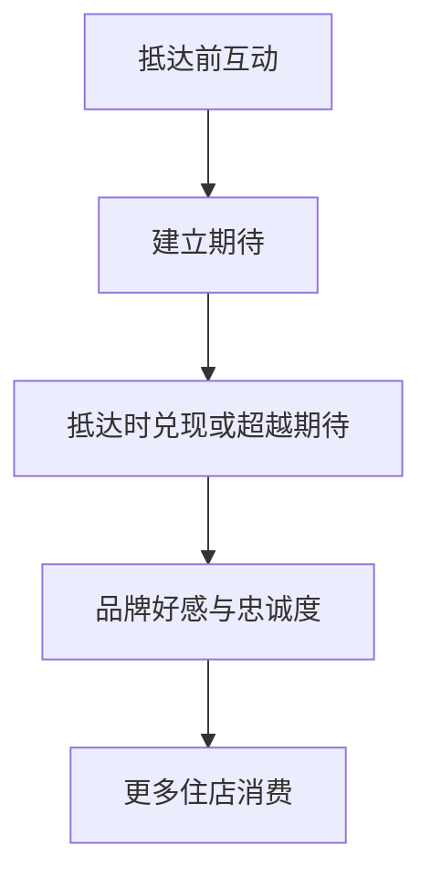

# 理解服务设计Brief

归档日期：2026-10-24（香港时间）。来源：`read_thread`；讨论 ID：`6a9a37b5-79b8-83ee-84e3-39ef033921c3`。

**范围：仅保存工具本次返回的 2 轮。不是整段历史对话的完整导出；未包含工具执行日志和图片内容。历史操作请求仅作背景资料。**

## 2026-09-04T03:15:18.606Z · 5510be40-e5dc-485a-a6cd-1f8278fefe18

### 用户

这是关于我服务设计课程的brief，你也阅读下

[User attached 1 image; image contents were not included]

### 助手

我已经完整读完了。这个 brief 的核心并不是“如何收集更多住客偏好”，而是：

> 如何在酒店真正有能力兑现的范围内，通过抵达前服务建立期待与参与感，同时避免因过度承诺而损害体验。

我的理解如下：

- 场景：客人完成预订后，到抵达酒店并办理入住前。
- 核心矛盾：个性化越深入，客人的期待越高，但运营复杂度也会快速增加。
- 关键风险：酒店一旦主动询问偏好，就等于作出承诺；未满足会产生负面 NPS，满足只是达到预期，超出预期才会真正加分。
- 运营难点：仅三个偏好问题就可能产生超过 27 种组合，还要应对每天 50+ 位到店客人、换房、订单变更、服务成本等变量。
- 既往尝试：之前做过“超个性化”试点，但由于运营复杂度太高而停止。
- 商业影响：由于发生在预订后，不影响预订转化，主要影响品牌资产、忠诚度以及客人在酒店内的消费。
- 外部利益相关者：从抵达前到入住阶段的住客。
- 内部利益相关者：目前由 Kate 作为代理人，不需要直接接触其他酒店内部人员。
- 已有资料：品牌材料、非机密 NPS 数据、LQE/文华东方服务标准，以及三项运营限制——周转效率、服务成本、入住时的灵活性。

所以后续做概念时，我会始终用三条标准来判断：

1. 能不能创造抵达前的期待感；
2. 能不能稳定兑现，而不是制造空头承诺；
3. 能不能在规模化运营下成立。

换句话说，这是一个“期待管理 × 可交付个性化 × 奢华品牌体验”的服务系统设计问题，而不只是设计一份问卷或一个入住前页面。后面你继续发课程资料、调研或小组想法给我，我会基于这份 brief 接着分析。

---

## 2026-09-04T03:17:11.588Z · 747ae745-6fb8-4b86-b418-824fd7148851

### 用户

- Brief contains two layers
  - What it states: the written problems, named people, known evidence, constraints, challenges
  - What it treats as true: unstated cases, missing people, preferred outcomes

请你帮我做着两层的梳理

### 助手

可以。这份 brief 表面上是在描述一个“抵达前体验”问题，但它同时预设了一套关于个性化、运营和商业价值的判断。

## 第一层：Brief 明确写了什么

| 维度 | Brief 中明确表达的内容 |
|---|---|
| 项目场景 | 文华东方酒店的住客完成预订后，到抵达酒店并办理入住前的阶段 |
| 核心问题 | 酒店希望识别并照顾客人的独特需求，同时控制内部运营负担 |
| 体验逻辑 | 一旦酒店主动询问偏好，就会建立期待；未兑现产生负面体验，兑现只是达到预期，超出预期才可能形成惊喜 |
| 运营复杂度 | 仅三个偏好问题就可能产生超过 27 种组合，并叠加每日 50+ 位到店客人、换房、订单变更和服务成本等问题 |
| 既往尝试 | 曾进行“超个性化”试点，但由于运营复杂度过高而被叫停 |
| 商业影响 | 发生在预订完成后，因此不影响预订转化；主要影响品牌资产、忠诚度和住店期间消费 |
| 设计挑战 | 如何在不过度承诺的前提下，在客人抵达前建立参与感并管理期待 |
| 外部利益相关者 | 从抵达前到办理入住阶段的住客 |
| 内部利益相关者 | Kate 作为酒店方代理人；现阶段不需要接触其他内部人员 |
| 已有证据 | 品牌材料、待提供的非机密 NPS 数据、LQE 服务标准、文华东方品牌标准和 Forbes Five Star 最低标准 |
| 明确限制 | 客流周转与效率、服务成本、入住环节的灵活性 |
| 理想结果 | 将品牌的 “allure of eastern mastery” 转化为抵达前的期待感，在入住时兑现或超越期待，最终促进忠诚度和住店消费 |

---

## 第二层：Brief 把什么当成了“事实”

这一层是 brief 没有充分证明，却用来构建问题的隐含假设。

### 1. 关于客人和需求的假设

| 隐含假设 | 被忽略或尚未验证的情况 |
|---|---|
| 客人希望在抵达前与酒店互动 | 有些客人可能只希望快速、无打扰地入住 |
| 个性化对客人来说天然有价值 | 个性化也可能显得侵入、繁琐或令人不安 |
| 客人能够提前准确表达自己的需求 | 有些需求可能临时变化，或客人并不知道酒店可以提供什么 |
| 所有偏好都具有相近的重要性 | 无障碍、过敏等必要需求，与枕头、香味等体验偏好的优先级明显不同 |
| “住客”可以作为一个整体研究 | 商务、度假、家庭、情侣、首次入住、回头客、VIP 和不同文化背景客人的期待可能完全不同 |
| 提问就意味着承诺 | 客人是否真的把所有偏好问题理解为保证，仍需要验证 |
| 更多互动会带来更多参与感 | 过多问题也可能增加认知负担，降低体验质量 |

### 2. 关于问题成因的假设

| 隐含假设 | 被忽略或尚未验证的情况 |
|---|---|
| 失败主要来自个性化选项太多 | 也可能来自跨部门信息断裂、责任不清、系统不互通或员工没有决策权限 |
| 27 种组合必须分别由运营团队处理 | 是否可以通过需求分级、模块化服务、自动匹配或默认选项降低复杂度，并未讨论 |
| 运营能力是固定边界 | 流程、岗位、系统和服务资源本身也可能被重新设计 |
| 以前的试点失败证明“超个性化不可行” | 失败也可能是执行方式、范围、技术或试点管理有问题，而非个性化本身无效 |
| 问题集中发生在抵达前 | 真正的服务断点可能出现在抵达前信息向前台、客房或餐饮团队传递的过程中 |
| “控制承诺”是主要解决方向 | 另一方向可能是提高兑现能力，或将固定承诺转化为可协商、可调整的服务安排 |

### 3. 关于利益相关者的假设

Brief 把住客设为唯一核心对象，并暂时以 Kate 代替所有内部人员。这意味着以下人员被排除在当前问题定义之外：

- 预订团队与客服
- 前台和礼宾
- 客房与保洁团队
- 餐饮、Spa、接送等服务部门
- 酒店管理层与值班经理
- CRM、会员系统、数字产品和 IT 团队
- 品牌、市场和忠诚度团队
- 财务及服务成本负责人
- 隐私、法务与数据治理人员
- OTA、旅行社、信用卡礼宾、企业差旅等预订中介
- 实际入住者之外的预订人、同行者和付款人

这隐含地把问题定义成了“客人体验设计”，但实际上它很可能是一个跨部门的服务交付系统问题。只依赖 Kate 作为代理人，也可能让研究过度反映管理层视角，而不是一线运营现实。

### 4. 关于证据的假设

| 隐含假设 | 可能存在的证据缺口 |
|---|---|
| NPS 能够反映抵达前体验质量 | NPS 通常反映整体入住体验，很难单独归因于抵达前阶段 |
| 满足期待得零分、超越期待得正分 | 这是一个有用的体验模型，但未必是实际 NPS 的直接计算或因果关系 |
| 品牌标准能够代表客人的真实需求 | 品牌标准描述酒店希望提供什么，不一定说明客人真正重视什么 |
| Kate 的经验足以确定三项运营限制 | Brief 也承认这些限制来自经验，而非数据 |
| 每天 50+ 位到店客人具有代表性 | 不同酒店、城市、旺季和客群的运营规模可能差异很大 |
| 之前试点的解释是可靠的 | Brief 没有提供试点流程、服务内容、失败指标和参与者反馈 |

### 5. 关于商业价值的假设

Brief 把以下因果链条当作理想方向：

但这条链条尚未被证明：

- 抵达前互动是否真的提升忠诚度？
- 忠诚度提升是否来自个性化，还是来自基础服务稳定性？
- 增加住店消费是否一定符合客人的利益？
- 过度强调消费，会不会让体验变成推销？
- 抵达前体验也可能影响取消率、升级购买、复购和推荐，但 brief 先排除了转化层面的价值。

### 6. Brief 偏好的解决结果

这份 brief 实际上已经对方案设置了倾向：

- 希望保留个性化，但降低其运营复杂度；
- 希望增加互动，而不是减少互动；
- 希望管理期待，而不是无限提高服务能力；
- 希望方案体现文华东方品牌，而不是成为通用酒店工具；
- 希望在客人抵达时产生可感知的兑现或惊喜；
- 希望最终能够支持忠诚度和住店消费；
- 倾向于可规模化、低成本、低运营风险的方案。

因此，后续研究不应直接接受“抵达前需要更多个性化”这个命题，而应该先验证三个更基础的问题：

1. 哪些需求值得酒店提前询问？
2. 哪些需求必须保证，哪些只能作为偏好或意向？
3. 个性化失败究竟来自需求太多，还是服务系统无法把信息转化为行动？

这三点会决定项目最终是在设计一个抵达前触点，还是重新设计一套“识别—判断—承诺—传递—兑现”的服务机制。
